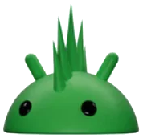

<p align="center"></p>

# ToyotaDash

A full-screen, flat-design dashboard for the **Toyota Yaris III Hybrid (100h)**, built to run
on an aftermarket Android head unit, an Android phone (with Android Auto) or an iPhone (with
CarPlay). Live data comes from a cheap **ELM327 OBD2 dongle over
Bluetooth Low Energy**, including the hybrid-specific values Toyota does not expose through
standard OBD2: high-voltage battery voltage, current, temperatures and per-block voltages.

> Personal project, not affiliated with Toyota. Sideloaded app, not published on the Play Store.

## Features

- **Speed, power and regen**: big speed readout, a power meter centred on zero (white = power
  drawn, green = energy recovered), engine RPM.
- **Hybrid battery**: state of charge, pack voltage, current, temperature, and a strip showing
  each of the 10 battery blocks (the weakest one is highlighted).
- **Energy flow**: engine / wheels / battery diagram with animated arrows and a plain-language
  sentence ("The battery drives the wheels", "Braking recharges the battery"…).
- **Drive mode**: EV / hybrid / regen / ready, plus ECO, EV MODE and POWER pills read from the
  head unit's own CAN decoder.
- **Energy history**: power over the last minute.
- **Connect screen**: BLE scan, signal strength, one-tap reconnect to the last dongle, demo mode.
- Immersive full screen, dark only, landscape, designed for 1024 × 600 at 160 dpi.

## Hardware

| | Tested with |
|---|---|
| Car | Toyota Yaris III Hybrid (1.5 VVT-i, 100 hp) |
| Head unit | Android 9, MediaTek MT8163, 1024 × 600 |
| Dongle | ELM327-compatible, **BLE** (GATT service `FFF0`, notify `FFF1`, write `FFF2`) |

Classic Bluetooth (SPP) ELM327 dongles are supported too. Other layouts (`FFE0`, `18F0`,
OBDLink) are tried automatically, with a fallback to any notify + write characteristic pair.

Other Toyota / Lexus hybrids sharing the same hybrid ECU (Prius, Auris, C-HR…) will probably
work for the most part, but the formulas below were only checked on a Yaris.

## Decoded data

Standard PIDs are read from `7DF`. The Toyota hybrid ECU answers on `7E2` → `7EA`
(mode `21`, receive filter set with `ATCRA`).

| Value | Request | Formula |
|---|---|---|
| Battery state of charge | `015B` | A × 100 / 255 |
| HV pack voltage | `7E2 2181`, bytes 22-23 | u16 / 10 |
| Block voltages (×10) | `7E2 2181`, bytes 0-19 | u16 × 79.99 / 65535 |
| HV current | `7E2 2198`, bytes 0-1 | (u16 − 32768) / 100, positive = discharge |
| Battery temperatures | `7E2 2187` | u16 × 255.9 / 65535 − 50 |
| MG1 / MG2 speed | `7E2 2161` / `2162`, bytes 3-4 | u16 − 32768 |

The sign of the current during regen and the mapping of the drive-mode values still need to
be confirmed on the road.

## Project layout

```
toyotadash/
├── shared/                Kotlin Multiplatform module, the OBD2 brain
│   ├── commonMain/        Pure Kotlin, shared by every app
│   │   ├── core/elm/      ELM327 protocol: transport interface, driver, response parsing
│   │   ├── core/pid/      Standard and Toyota hybrid PID definitions
│   │   └── core/dash/     Reading loop, decoding, hybrid state, energy flows, demo drive
│   ├── androidMain/       Android Bluetooth: BLE GATT + Classic SPP transports, scan
│   ├── iosMain/           iOS: CoreBluetooth transport, DashController (entry point for Swift)
│   └── commonTest/        Unit tests, run on the JVM and on the iOS simulator
├── androidApp/            Android app for head units and phones (Jetpack Compose, full screen)
│   ├── car/               Android Auto cockpit (Car App Library, drawn on the car surface)
│   ├── data/canbus/       Head-unit vehicle data (Settings.System) for ECO / EV mode
│   ├── data/debug/        Debug TCP bridge
│   └── ui/obd/            Connect screen, dashboard, raw-data view, flat palette
└── ios/                   iPhone app (SwiftUI) + CarPlay cockpit, project generated by XcodeGen
```

Stack: Kotlin Multiplatform, Jetpack Compose (Canvas for the custom gauges), coroutines / StateFlow.
No third-party runtime dependencies.

## Build & run

Requirements: Android Studio (recent), JDK 11+, an Android device or emulator (min SDK 24).

```bash
./gradlew :androidApp:assembleDebug
adb install androidApp/build/outputs/apk/debug/androidApp-debug.apk
```

Unit tests (protocol parsing, PID formulas checked against frames read on the car,
reading loop with a scripted fake ELM327):

```bash
./gradlew :shared:jvmTest                  # on the JVM
./gradlew :shared:iosSimulatorArm64Test    # on the iOS simulator
```

### iPhone app

Requirements: Xcode, [XcodeGen](https://github.com/yonaskolb/XcodeGen), a JDK (Gradle builds the
Kotlin framework during the Xcode build).

```bash
cd ios && xcodegen && open ToyotaDash.xcodeproj
```

Pick your team in *Signing & Capabilities* to run it on an iPhone. The iOS simulator has no
Bluetooth: launch it with the `-demo` argument (or tap *Mode démo*) to see the dashboard.

No dongle or car? Debug builds have a simulator and fake dongles:

```bash
adb shell am start -n com.moudjane.toyotadash/.MainActivity --ez demo true        # simulated drive
adb shell am start -n com.moudjane.toyotadash/.MainActivity --ez fakedongles true # fake scan results
```

For a realistic preview, set the emulator to the head unit's screen:
`adb shell wm size 1024x600 && adb shell wm density 160`.

### Debug bridge (debug builds only)

While the app is open and **not** connected to the dongle, it exposes two local ports, which is
handy from Termux on a head unit without root or ADB:

- `127.0.0.1:35000`: TCP ↔ dongle relay. Lists the dongles, lets you pick one, then forwards
  raw ELM327 commands (`nc 127.0.0.1 35000`).
- `127.0.0.1:35001`: dumps the vehicle values published by the head unit.

### Local config

Machine-specific values (head unit IP, SSH credentials) live in `.env`, which is git-ignored.
Copy `.env.example` to `.env` and fill it in. Nothing in it is needed to build the app.

## Disclaimer

Reading OBD2 data is passive, but keep your eyes on the road: this dashboard is meant to be
glanced at, not studied while driving. Use at your own risk.

## Credits

- Font: [Barlow](https://github.com/jpt/barlow), SIL Open Font License
  (`androidApp/src/main/assets/licenses/Barlow-OFL.txt`).
- Toyota hybrid PID formulas cross-checked against community work on Toyota hybrid diagnostics
  and validated on the car.
